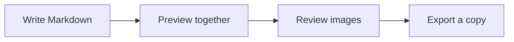
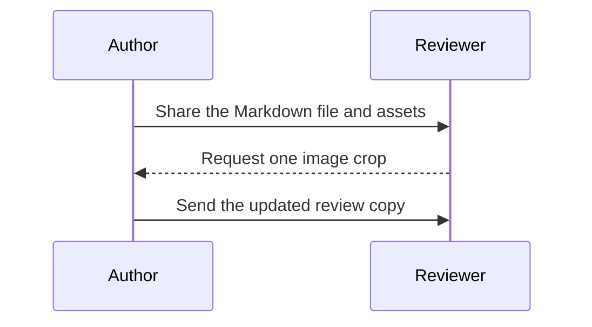

# Documentation release kit

A local Markdown workbench for **writing**, *reviewing* and publishing. All names, dates and numbers in this demonstration are fictional.

## Release checklist

- [x] Draft the installation guide
- [x] Add a screenshot and a diagram
- [x] Review links and image descriptions
- [ ] Export the review copy

## Review status

| Document | Owner | Progress | Ready |
| :--- | :--- | ---: | :---: |
| Getting started | Alex | 100% | Yes |
| Image workflow | Sam | 75% | Review |
| Release notes | Robin | 50% | Draft |

## From draft to release



## Local image

The image below uses a relative path. Open its image tools to crop, rotate or resize the demonstration asset.


## Code with syntax highlighting

```javascript
const release = {
  title: "Documentation release kit",
  reviewed: 18,
  total: 24
};

function readiness({ reviewed, total }) {
  return `${Math.round(reviewed / total * 100)}% ready`;
}

console.log(readiness(release)); // 75% ready
```

## Math notes

Inline math: $r = n / N$. A display equation makes the same calculation easier to review:

$$
\text{Readiness} = \frac{18}{24} \times 100\% = 75\%
$$

## Review conversation



## Links, quotes and footnotes

Read the [project overview](https://notepad-plus-plus-mac.com/en/) or jump back to the [review status](#review-status).

> Keep the Markdown file and its local assets together.
>
> Moving only the text file can break relative image paths.

A review copy is a snapshot of the document at one point in time.[^review]

[^review]: This demonstration uses fictional content and is not a benchmark or customer data.

## Nested lists and inline formatting

1. Review the text.
   - Check **important terms** and *emphasis*.
   - Remove ~~outdated wording~~.
2. Review the assets.
   - Check the `assets/` folder.
   - Confirm every image has useful alternative text.
3. Save the Markdown source before exporting.

### Headings make long files easier to navigate

Use the preview's outline to move between sections. Click a rendered heading or paragraph to locate its source.

#### A smaller subsection

This paragraph demonstrates another heading depth and a [reference-style link][markdown-guide].

[markdown-guide]: https://www.markdownguide.org/basic-syntax/

---

## Publishing handoff

The source stays in a normal `.md` file. Keep a separate copy of important images before saving an edited version.

- File: `markdown-showcase.md`
- Local asset: `assets/mountain-lake.png`
- Intended use: documentation writing, image editing and preview demonstrations
